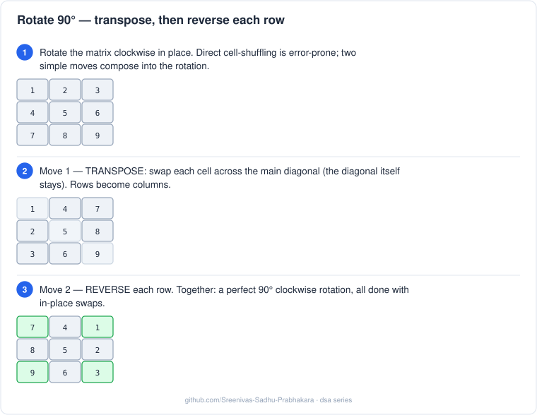

# Rotate Matrix by 90 Degrees

> Striver SDE Sheet 007 · Day 2 Arrays — transpose across the diagonal, then reverse each row, all in place. Go, stdlib only, tested.

## Problem

Rotate an n×n matrix 90 degrees clockwise, in place — no second matrix allowed.

## Approach

A clockwise rotation maps row r to column n−1−r. That is exactly the composition of two simple in-place moves: transpose (swap `m[r][c]` with `m[c][r]` above the diagonal) turns rows into columns, then reversing each row fixes the column order. Each element is touched twice, every move is a swap, so nothing extra is allocated. The same trick with the steps swapped (reverse rows, then transpose) gives a counter-clockwise rotation.

**Complexity:** O(n²) time, O(1) space.

## Visual walkthrough

Read the picture top to bottom — each numbered frame is one moment of the algorithm
running on this repo's test example.

## Run

    go test ./...   # verify
    go run .        # demo

---

One of 191 repos solving Striver's SDE Sheet in Go — stdlib only, one problem per repo, every solution tested. Browse the set: [`dsa-*` repos](https://github.com/Sreenivas-Sadhu-Prabhakara?tab=repositories&q=dsa-&type=source).
